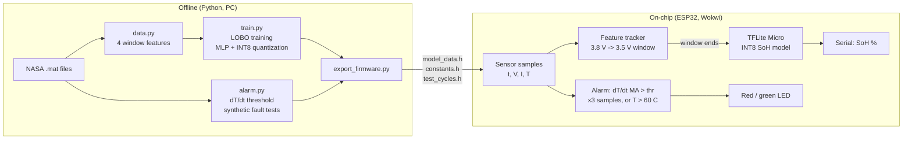
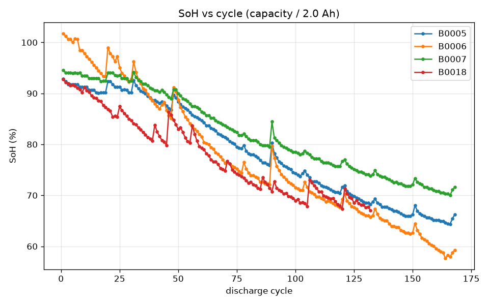
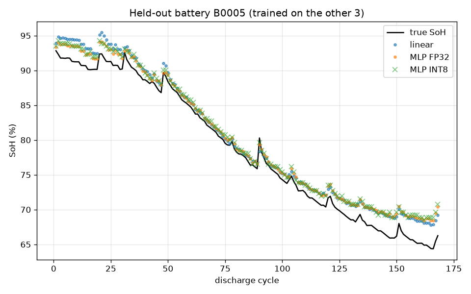

# SafeCell AI

On-chip battery health (SoH) estimation and overheating alarm for an EV battery management system (BMS), running on a simulated ESP32 with TensorFlow Lite Micro.

## Problem

In 2022, electric scooters caught fire across India. Ola recalled 1,441 scooters, Okinawa over 3,000 and PureEV around 2,000, and two people died in Vellore. Battery fires usually start with abnormal heating, and battery state of health (SoH) keeps dropping as cells age. A BMS chip must catch both **on the device, in real time, without internet**.

## Solution

SafeCell AI runs on the BMS microcontroller (ESP32, simulated in Wokwi):

1. **SoH estimator**: a tiny INT8 neural network (4 → 16 → 8 → 1) predicts battery health from a short 3.8 V → 3.5 V slice of each discharge. Unlike coulomb counting, it does not need a full discharge.
2. **Overheating alarm**: a threshold on the rate of temperature rise (dT/dt) learned from normal data, plus a 60 °C hard limit. It is deliberately not ML, because a safety alarm must be predictable and easy to verify.

Output: SoH % over serial, **green LED = normal, red LED = alarm**.

## Architecture



## Dataset

NASA PCoE Li-ion Battery Aging dataset (PCoE data set repository #5, downloaded from [phm-datasets.s3.amazonaws.com](https://phm-datasets.s3.amazonaws.com/NASA/5.+Battery+Data+Set.zip), 210 MB zip), batteries **B0005, B0006, B0007, B0018**.

- 18650 Li-ion cells at room temperature. Charged at a constant 1.5 A to 4.2 V, then held at constant voltage until the current fell to 20 mA. Discharged at a constant 2 A to 2.7 / 2.5 / 2.2 / 2.5 V.
- Stopped at a 30% capacity fade. The README in the dataset gives the **rated capacity: 2 Ah** (from 2 Ah to 1.4 Ah).
- Only discharge cycles are used: 168 + 168 + 168 + 132 = **636 cycles**. **0 cycles were dropped** as broken (no bad capacity, all time vectors increasing, every cycle crosses 3.8 V and 3.5 V).
- **SoH label** = cycle capacity / 2.0 Ah × 100. The range is 57.7% to 101.8%.
- **Capacity regeneration**: after rest periods, capacity sometimes jumps up for a few cycles (visible in `results/soh_vs_cycle.png`). It is a real electrochemical effect, so it is **kept as is**.



## Features (`src/data.py`)

All 4 features come from the start of the discharge and from a short voltage window. The window (3.8 V → 3.5 V) was chosen after plotting the curves (`results/voltage_curves.png`): every cycle of every battery passes through it, in the flat middle part of the discharge.

| Feature | Meaning | Why it relates to SoH |
|---|---|---|
| `dt_window` | seconds to fall from 3.8 V to 3.5 V | less capacity → the cell crosses the window faster (about 1,720 s → 500–940 s) |
| `temp_start` | temperature when the window starts | heat generation changes with ageing |
| `temp_rise` | temperature rise inside the window | higher internal resistance → more I²R heat |
| `v_drop_60s` | voltage drop in the first 60 s | higher internal resistance → bigger IR drop when the 2 A load starts |

Each feature uses the **first sample** at or below each voltage, so the ESP32 can compute it live, one sample at a time, with no look-ahead.

## Results

### SoH model: leave-one-battery-out (`src/train.py`)

Train on 3 batteries and test on the 4th, repeated for all 4. Cycles are never split randomly. The scaler is fit on training batteries only. All values are SoH percentage points.

| Held-out battery | Linear MAE | Linear RMSE | MLP FP32 MAE | MLP FP32 RMSE | MLP INT8 MAE | MLP INT8 RMSE |
|---|---|---|---|---|---|---|
| B0005 | 1.72 | 1.98 | 1.62 | 1.89 | 1.78 | 2.04 |
| B0006 | 4.77 | 4.95 | 4.53 | 4.94 | 4.56 | 4.97 |
| B0007 | 1.00 | 1.27 | 0.98 | 1.19 | 0.94 | 1.14 |
| B0018 | 2.13 | 2.25 | 3.31 | 3.55 | 3.46 | 3.69 |
| **Average** | **2.41** | **2.61** | **2.61** | **2.89** | **2.69** | **2.96** |

| Model file (B0005-held-out fold) | Size |
|---|---|
| FP32 `.tflite` | 2,800 bytes |
| INT8 `.tflite` (per-tensor, deployed) | **2,576 bytes** |

What this shows:
- **Average MAE ≤ 3% target: met** by all three models (INT8: 2.69%). **INT8 < 10 KB target: met** (2,576 bytes).
- **INT8 quantization cost only +0.08% MAE** versus FP32 (2.69% vs 2.61%).
- **Per-channel vs per-tensor (a real bug found in Wokwi).** The default TF 2.19 converter gives Dense layers *per-channel* weight scales. That INT8 file was 3,104 bytes, *larger* than FP32 because of one scale per output channel, and scored 2.66% MAE in Python. But the older TensorFlow Lite Micro in the `TensorFlowLite_ESP32` library only reads one scale per weight tensor, so on the ESP32 it predicted 50.0 / 47.3 / 46.2 / 45.0% for cycles whose true SoH was 92.8 / 77.4 / 66.3 / 65.2%. Forcing per-tensor quantization for Dense layers fixed it, and the ESP32 now matches Python to 0.1%.
- **The linear baseline is as good as the MLP on average.** The 4 features are close to linearly related to SoH on this constant-current lab data, so the MLP mainly demonstrates the TinyML deployment pipeline.
- **B0006 is the hardest** (about 4.5–4.8% for every model). It starts at 101.8% and fades to 57.7%, outside the range of the other three batteries, so the models must extrapolate.
- MLP training uses L2 = 1e-3, Adam lr = 0.001, 400 epochs. Without L2, the MLP scored 8.55% MAE on B0018. These settings were picked after seeing the LOBO results, so the MLP numbers carry some selection bias.



### Overheating alarm (`src/alarm.py`)

- dT/dt is computed per sample and smoothed with a 3-sample moving average.
- Threshold = 99.9th percentile of dT/dt on the 3 training batteries × 1.5. For example, 0.0352 °C/s when B0005 is held out.
- Alarm if dT/dt > threshold for 3 samples in a row, **or** temperature > 60 °C.
- The dataset has no real fires, so faults are synthetic. On every held-out cycle, a heating ramp is added from a random start time (10–60% of the cycle).

| Fault slope (°C/s) | Cycles | Detection rate | Avg time to alarm | Caught by dT/dt | Caught by 60 °C limit |
|---|---|---|---|---|---|
| 0.01 | 636 | 42.3% | 1,992 s | 95 | 174 |
| 0.02 | 636 | 97.5% | 941 s | 167 | 453 |
| 0.05 | 636 | **100%** | **46.7 s** | 636 | 0 |
| 0.10 | 636 | **100%** | **37.3 s** | 636 | 0 |

**False alarms on clean cycles: 2 / 636 (target was 0, not met).** Both are on B0007 when it is held out. Its threshold, learned from the other three batteries, is lower (0.0230 °C/s), and both alarms happen after the end of discharge (current = 0, V ≈ 2.8 V), when B0007's deep 2.2 V cutoff makes the cell keep heating for a few seconds. Fast faults (≥ 0.05 °C/s) are caught within about 4–5 samples. Slow faults (0.01 °C/s) look like normal discharge heating, which a rate threshold cannot separate.

### ESP32 firmware (`firmware/esp32/`, Wokwi)

The firmware streams 4 real discharge cycles from held-out battery B0005 one sample at a time, like live sensor readings: early, mid and late life, plus a late cycle with a 0.05 °C/s heating ramp injected from t = 1200 s. On every sample it runs the alarm. When the 3.8 → 3.5 V window closes, it runs the INT8 model with TensorFlow Lite Micro. Full log: `results/wokwi_serial_log.txt`.

| Cycle | ESP32 SoH | Python INT8 SoH | True SoH | 4 features ESP32 vs Python | Alarm |
|---|---|---|---|---|---|
| early (1) | 93.5% | 93.47% | 92.8% | identical | none (green) |
| mid (84) | 78.1% | 78.09% | 77.4% | identical | none (green) |
| late (168) | 70.4% | 70.39% | 66.3% | identical | none (green) |
| late + fault (160) | 68.9% | 68.85% | 65.2% | identical | **t = 1237.8 s, dT/dt = 0.0549 °C/s** (red), same as Python |

The ESP32 feature values (`dt_window`, `temp_start`, `temp_rise`, `v_drop_60s`, printed to 3–4 decimals) match `results/firmware_expected.csv` for all 4 cycles.

| On-chip metric | Value |
|---|---|
| INT8 model size | 2,576 bytes |
| Tensor arena used | 756 of 4,096 bytes |
| Average inference time | **865 µs** (measured in Wokwi simulation) |
| Firmware RAM (static) | 31,544 bytes (9.6% of 320 KB) |
| Firmware flash | 525,369 bytes (40.1% of 1.25 MB app partition) |
| Time from fault start to alarm | 37.8 s (4 samples at about 9.4 s per sample) |

## How to run

```bash
python -m venv .venv
.venv\Scripts\activate            # Windows (Linux/macOS: source .venv/bin/activate)
pip install -r requirements.txt
```

1. Download the dataset zip from the link above, unzip `1. BatteryAgingARC-FY08Q4.zip`, and put `B0005.mat`, `B0006.mat`, `B0007.mat` and `B0018.mat` in `data/raw/`.
2. Run the pipeline:
   ```bash
   python src/data.py             # features.csv + plots
   python src/train.py            # SoH models, INT8 model, soh_results.csv
   python src/alarm.py            # alarm_results.csv
   python src/export_firmware.py  # firmware/esp32/include/*.h
   ```
3. Build the firmware: `cd firmware/esp32 && pio run` (PlatformIO, `espressif32@6.9.0`)
4. Simulate, either way:
   - **VS Code**: open `firmware/esp32` with the Wokwi extension and run **Wokwi: Start Simulator** (uses `wokwi.toml` + `diagram.json`).
   - **wokwi.com**: start a new ESP32 project and paste `diagram.json`. Merge the build into one image with `esptool.py --chip esp32 merge_bin -o safecell_merged.bin 0x1000 bootloader.bin 0x8000 partitions.bin 0xe000 boot_app0.bin 0x10000 firmware.bin`. Then press F1 → **Upload Firmware and Start Simulation…** and pick `safecell_merged.bin`.

## Repository layout

```
src/data.py             load .mat files, 4 features, SoH label, plots
src/train.py            linear + MLP, leave-one-battery-out, INT8 TFLite
src/alarm.py            dT/dt threshold, synthetic faults, alarm metrics
src/export_firmware.py  model / constants / test cycles -> C headers
firmware/esp32/         PlatformIO project + Wokwi diagram
results/                csv results, plots, exported models
```

## Limitations

- **Lab data**: 4 cells, one chemistry, at room temperature.
- **Constant-current 2 A discharge only**: a real scooter has changing loads, so the 3.8 → 3.5 V window timing would need a load-normalised version.
- **Only 4 batteries**: leave-one-battery-out with 4 folds is a small test. B0006 shows that cells degrading outside the training range get worse predictions.
- **Synthetic faults**: no real thermal-runaway data. The heating ramps are linear, which real faults may not be.
- **Simulated timing**: inference times come from the Wokwi simulator, not real silicon.
- The MLP regularisation was chosen after seeing LOBO results (mild selection bias), and the linear model performs just as well.

## Future work

- Real EV data with changing loads (drive cycles), and load-independent features.
- Send SoH and alarms over CAN to the vehicle ECU / dashboard.
